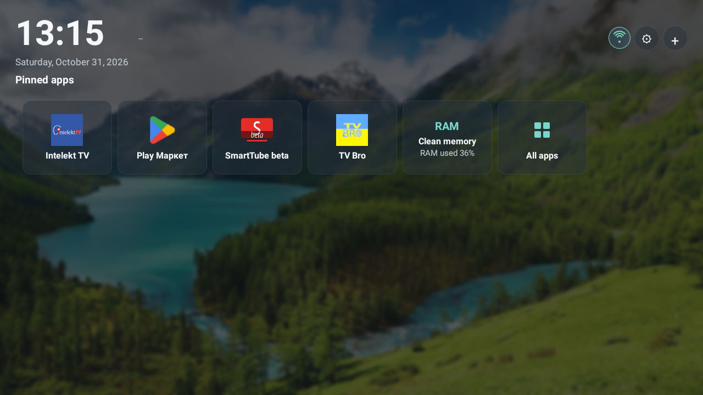
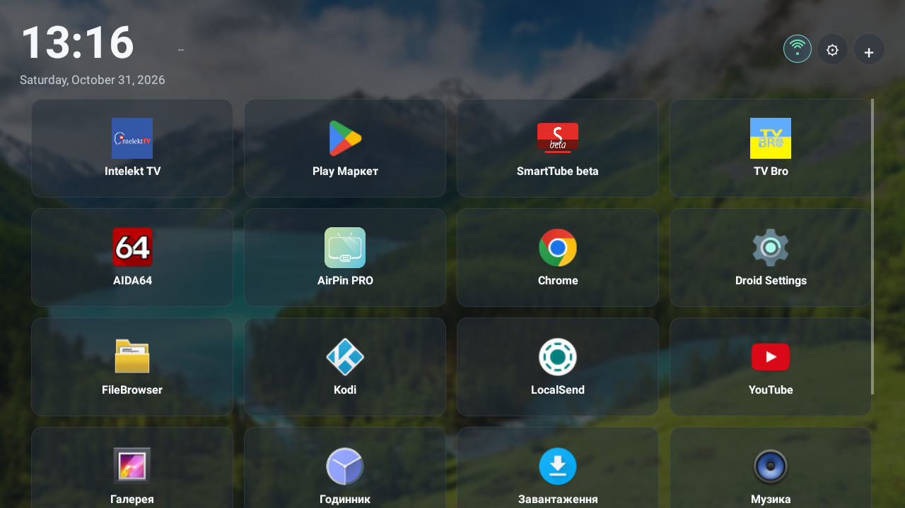
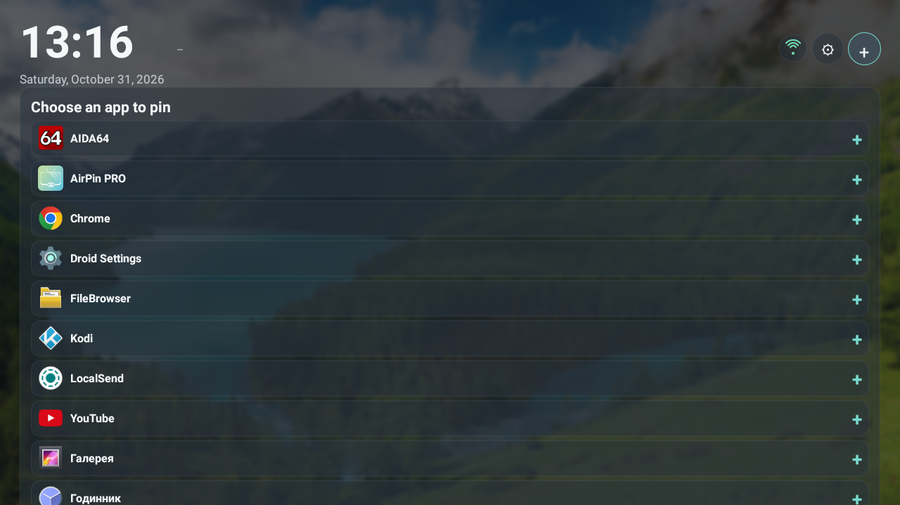
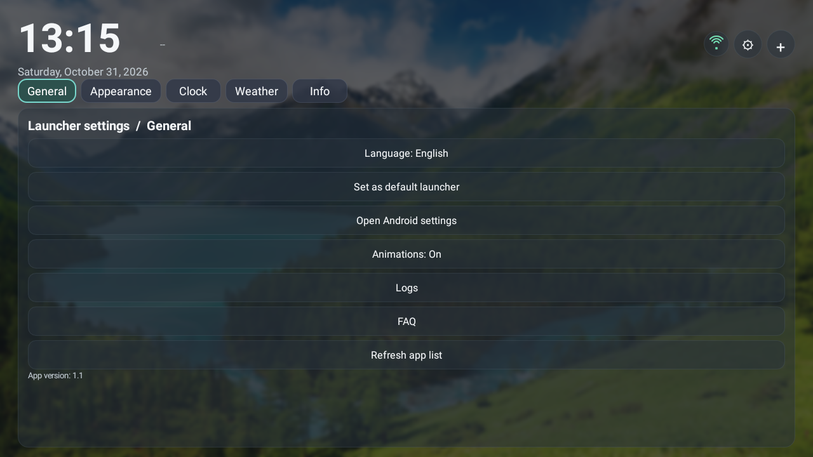
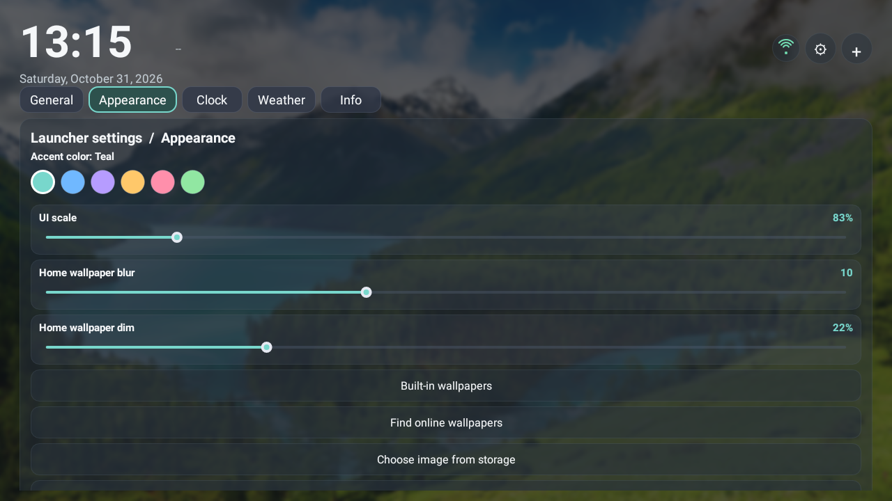
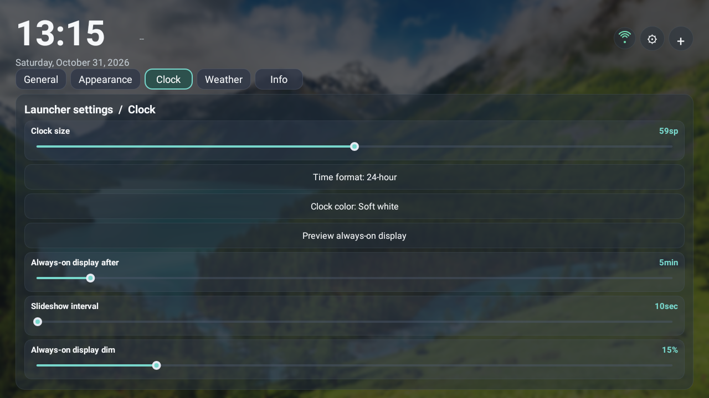
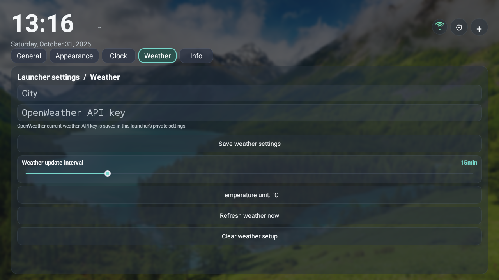
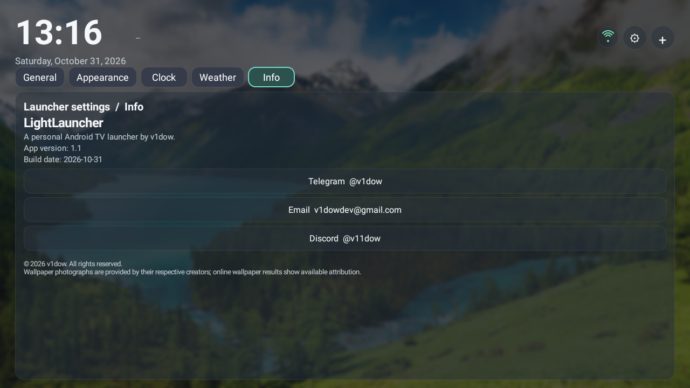
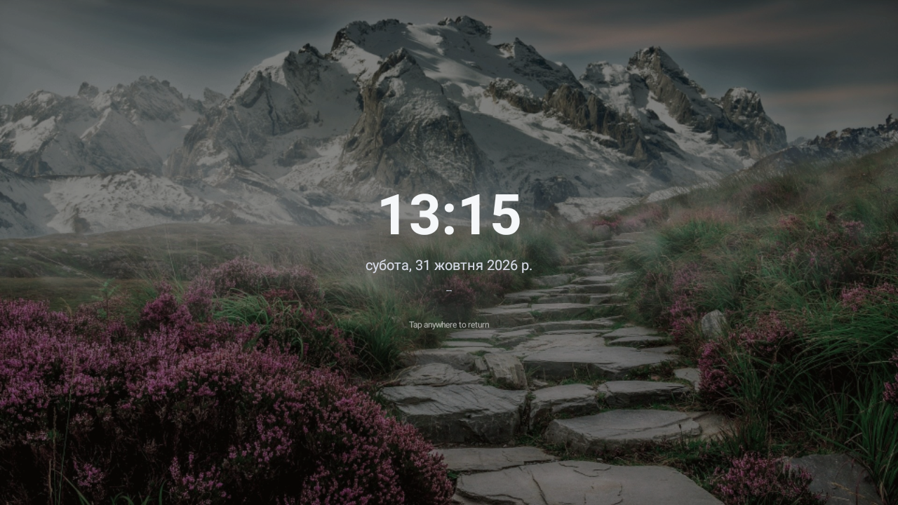

# LightLauncher

LightLauncher is a customizable, remote-friendly Android home screen designed for Android TV boxes and landscape displays. It keeps the main controls easy to reach with a remote while also supporting touch.

## Screenshots

<table>
  <tr>
    <td></td>
    <td></td>
  </tr>
  <tr>
    <td></td>
    <td></td>
  </tr>
  <tr>
    <td></td>
    <td></td>
  </tr>
  <tr>
    <td></td>
    <td></td>
  </tr>
  <tr>
    <td></td>
    <td></td>
  </tr>
</table>
## Features

- **TV-friendly launcher:** browse installed apps, pin up to five favorites, and keep the app list updated when apps are installed or removed.
- **Adjustable appearance:** change interface scale, choose an accent color, and adjust wallpaper blur and dimming with fine-grained sliders.
- **Wallpaper library:** choose from nine bundled Full HD wallpapers, pick an image from storage, or open the online wallpaper browser. Online suggestions load automatically and can be filtered with a search; results include previews and available attribution details and are limited to landscape images at least 1920 x 1080. A direct HTTPS image URL is also supported.
- **Clock and always-on display:** customize clock size, color, and time format; preview the always-on display; and adjust its dim level, idle delay, and wallpaper slideshow interval. The date scales with the clock.
- **Weather widget:** show current conditions and a weather icon beside the home-screen clock, with a time-based greeting. Configure a city, OpenWeather API key, temperature units, and refresh interval. The widget displays `--` until it has valid weather data.
- **System indicators:** see Wi-Fi connection state and signal strength, plus RAM usage. The memory action requests cleanup from Android; system services may remain active.
- **Settings and help:** in-app settings sections, remote-friendly focus highlighting, subtle animations, FAQ, and an Info page with developer contact links.
- **Language choices:** English, Ukrainian, Spanish, French, German, Polish, Italian, Turkish, Arabic, Russian, and Portuguese.

### Built-in wallpapers

The wallpaper picker uses descriptive names:

- Alpine Blossom Pass
- Violet Peak at Dusk
- Lakeside Mountain Cabin
- Golden Hour Tree
- Balloon Over Misty Lake
- Starfall Reflections
- Turquoise Alpine Shore
- Mirror Lake Peaks
- Emerald Valley Waters

### Weather setup

Open **Settings в†’ Weather**, enter a city and an OpenWeather API key, then save. Choose Celsius or Fahrenheit and an automatic update interval from 5 to 60 minutes. The key is stored in the launcher's private app settings.

## Build

The project builds a landscape TV launcher and a portrait variant. To build just the landscape APK from the project root in PowerShell:

```powershell
.\gradlew.bat assembleTvDebug
```

The landscape APK is written to:

```text
app\build\outputs\apk\tv\debug\app-tv-debug.apk
```

To build both variants and copy them to `dist`, run:

```powershell
.\scripts\build.ps1
```

Build requirements: Windows PowerShell, JDK 17, Android SDK Platform 36, Android Build Tools, and the included Gradle wrapper. Set `JAVA_HOME` and `ANDROID_HOME` (or `ANDROID_SDK_ROOT`) if the tools are not detected automatically.

## Remote controls

- **Up / Down:** move focus through the screen and settings.
- **Left / Right:** move focus; when a slider is focused, adjust its value.
- **OK / Enter:** open the focused app or control.
- **Long-press OK on an app:** pin or unpin it.
- **Home:** return to the pinned-app screen.
- **Back:** return to the previous launcher page.

## Project layout

```text
app/src/main/AndroidManifest.xml                  Shared app manifest
app/src/main/java/com/android/lightlauncher/     Launcher UI and behavior
app/src/main/assets/wallpapers/                   Bundled wallpaper images
app/src/main/res/                                 Theme and app icon
app/src/tv/                                       Landscape TV settings
app/src/portrait/                                 Portrait variant settings
screenshots/                                      README screenshots
scripts/build.ps1                                 Build and copy both APK variants
```

## Notes

- The wallpaper browser searches Wikimedia Commons, previews image results, and displays available creator and license details. Check each image's license and attribution before redistribution.
- Debug APKs are signed with a debug key and are intended for development or sideloading.
- Android controls background process management; the memory action cannot force-stop essential system services.
- The Info page includes Telegram `@v1dow`, email `v1dowdev@gmail.com`, and Discord `@v11dow`.


